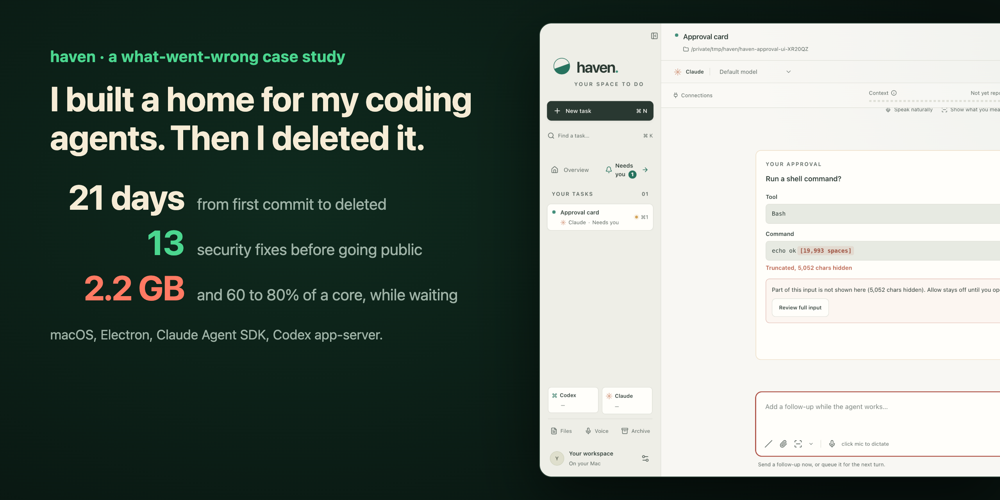
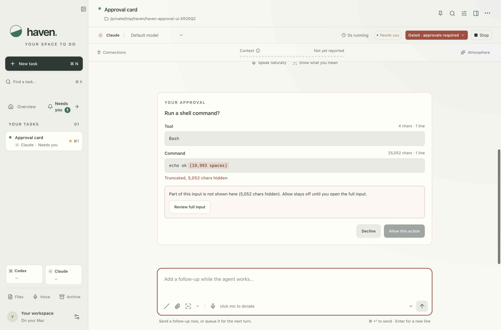
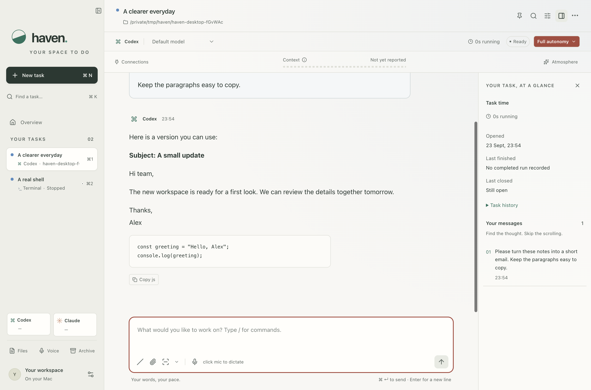
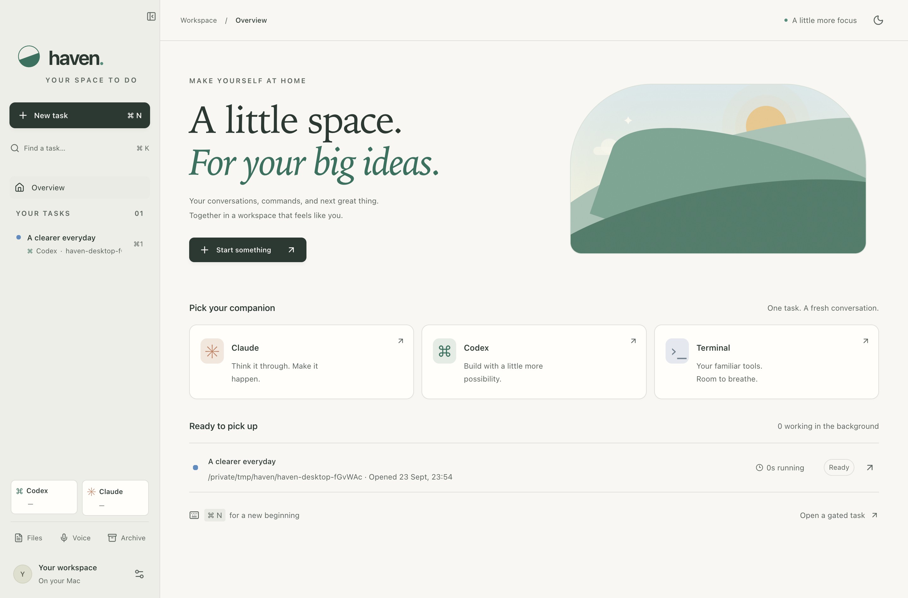
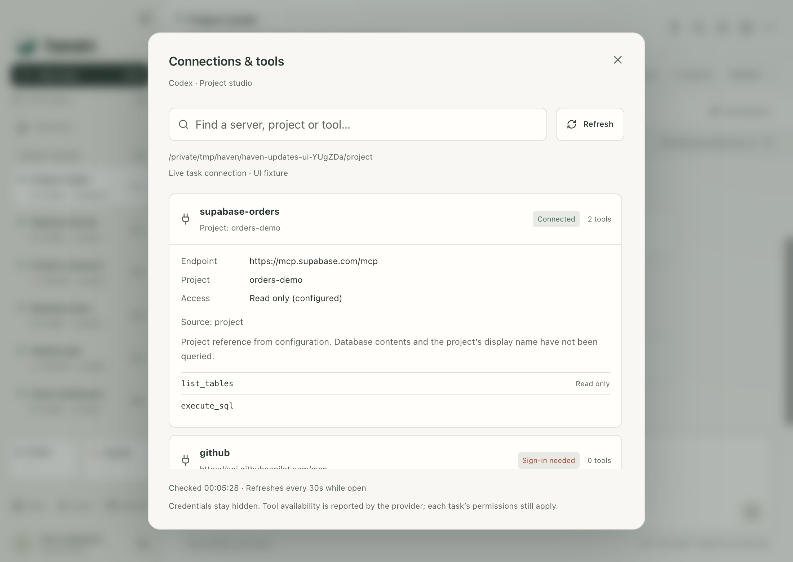

# Haven

**I built a home for my coding agents. Then I deleted it.**

[](#what-went-wrong)
[](#the-build)
[](https://github.com/AIwithDiego/haven/actions/workflows/ci.yml)


[](LICENSE)

[](#what-went-wrong)

A case study. A calm macOS workspace for Claude Code, Codex and real terminals, side by side as named tasks. Built in Dublin with AI coding agents, first commit 21 September 2026, published here as 0.5.0 on 24 September, used every day, retired on 12 October. <!-- TODO(Diego): confirm the tools you built Haven with (Claude Code only, or Claude Code and Codex) and name them in this line. -->

**[Why I deleted it](#what-went-wrong)** · [What it got right](#what-it-does) · [Run it yourself](#run-it-yourself)

**Contents:** [The problem](#the-problem) · [Research](#research) · [What it does](#what-it-does) · [The build](#the-build) · [What went wrong](#what-went-wrong) · [What I learned](#what-i-learned) · [Run it yourself](#run-it-yourself)

## The problem

I run five or more coding agents and shells at once. In terminal tabs that gets hard fast:

- **Hard to read.** Long agent replies scroll past in a monospace wall, and tables and code blocks lose their shape.
- **Hard to copy from.** Selecting a paragraph drags in prompt lines, box-drawing characters and wrapped whitespace.
- **Hard to keep track of.** Tabs called `zsh` and `node` don't say which one is waiting on me, or which folder it's in.
- **Hard to trust.** An approval prompt in a terminal can show a tool name and a cut-off command, and still ask "Allow?".

> The provider apps each host one agent. I wanted Claude, Codex and a real shell as equal tasks in one calm window, on my own Mac, with nothing in between.

## Research

**What already exists.** Before building past the first version I mapped the field (21 September 2026): Claude Code Desktop and the Codex app (free with the plans, one provider each), multi-agent orchestrators like Conductor, Emdash and Claude Squad, terminal-first hosts like Warp, cmux and Wave, and dictation apps like Wispr Flow and Superwhisper. Nobody combined SDK chats and a real terminal as equal tabs, with both Claude and Codex. Almost everybody had things Haven didn't: a git worktree per task, a diff panel, PRs from inside the app.

**Who it's for.** Me. One person, one Mac, daily use. The research ended with a decision: don't sell it, use it and show it.

**The limits we chose.** Local only: no Haven server, no API keys, no telemetry. It drives the `claude` and `codex` CLIs already installed, with their own sign-ins, skills and project settings. macOS on Apple Silicon only, self-signed, not notarized. And because it hands real shells and agents to a UI, the human stays in charge of what runs.

**What I didn't build.**

| Choice | Why | Trade-off |
|---|---|---|
| Drive the installed CLIs, not the APIs | Keeps my sign-ins, skills and settings; no keys to store | Every feature the CLI gives a terminal for free had to be rebuilt or wired through |
| Electron, not a native Swift app | React UI, xterm.js and the Agent SDK in one language | A heavy main process; it became the bottleneck (see [What went wrong](#what-went-wrong)) |
| No worktrees, diff panel or PRs | Git stays in the terminal and the agents | Missing what nearly every competitor treats as table stakes |
| Local Whisper dictation | Audio never leaves the Mac | 1 GB of model held in memory |

## What it does

Each piece of work is a task: a name, a folder, and Claude, Codex or a real zsh terminal. Conversations are formatted, selectable and copyable. When an agent wants to run something, Haven shows exactly what would run before you allow it.

| | What it is | Where |
|---|---|---|
| **Tasks** | Named tasks with a folder and an agent or shell; pinning, `⌘1` to `⌘9`, a "Needs you" shortcut, `⌘K` search, archive and restore | [`electron/workspace.mjs`](electron/workspace.mjs), [`src/App.tsx`](src/App.tsx) |
| **Claude and Codex** | Claude through the Agent SDK, Codex through its app-server; per-task model, effort and permission profile; follow-ups while a turn runs | [`electron/agents.mjs`](electron/agents.mjs) |
| **Approval card** | Shows the decisive input inline; if any of it is hidden, Allow stays off until you open it, enforced in the main process | [`electron/approval.mjs`](electron/approval.mjs) |
| **Gated profile** | A `PreToolUse` hook on every tool call that allow rules can't skip; silent reads scoped to the task folder | [`electron/permissions.mjs`](electron/permissions.mjs) |
| **Links and files** | Links that look like they carry data ask first and show the full URL; files outside the task folder ask first | [`electron/links.mjs`](electron/links.mjs) |
| **Real terminals** | PTY-backed zsh rendered with xterm.js | [`helpers/terminal.py`](helpers/terminal.py) |
| **Reader** | Markdown, JSON, YAML, CSV and TSV in a focused reader; CSV as filterable tables | [`src/MarkdownReader.tsx`](src/MarkdownReader.tsx) |
| **Dictation** | Push-to-talk with local Whisper, weights checked against the published SHA256 | [`helpers/dictation.py`](helpers/dictation.py) |

<table>
<tr>
<td width="50%"></td>
<td width="50%"></td>
</tr>
<tr>
<td>The approval card. 5,052 characters hidden, so Allow stays off.</td>
<td>A Codex conversation you can read and copy, with the task panel.</td>
</tr>
</table>

<table>
<tr>
<td width="50%"></td>
<td width="50%"></td>
</tr>
<tr>
<td>Overview: pick Claude, Codex or a terminal.</td>
<td>Connections: what a task can reach, never its credentials.</td>
</tr>
</table>

Screenshots come from the Playwright suites running the source build against throwaway data.


1. **Renderer** (`src/`): React 19, Radix, Tailwind v4, xterm.js and react-markdown, with `sandbox: true`, `contextIsolation: true` and a strict Content Security Policy. It never touches the filesystem or spawns anything.
2. **Bridge** ([`electron/preload.cjs`](electron/preload.cjs)): allowlisted actions and events only. The main process accepts IPC only from Haven's own window and frame, and validates every action ([`electron/validation.mjs`](electron/validation.mjs)).
3. **Main process** ([`electron/`](electron/)): owns all state and every child process. Folder trust comes before a project's hooks and `.mcp.json` servers load, because the SDK skips Claude Code's own trust prompt.
4. **Child processes**: Claude Code through `@anthropic-ai/claude-agent-sdk`, `codex app-server` over JSON-RPC, a PTY helper and a dictation helper, each with an allowlisted environment. Packaged builds turn off the `RunAsNode`, `NODE_OPTIONS` and `--inspect` fuses, so another local process can't borrow Haven's microphone, screen and accessibility permissions.

## The build

One person and AI coding agents, three weeks. Before publishing, Haven went through a full security review: 13 fixes, from what the approval card shows to Electron fuses and links that could leak data. This repo is the clean public copy of 0.5.0 with those fixes in. Versions 0.6 to 0.10 stayed in a private working repo; they are where most of [What went wrong](#what-went-wrong) happened, and they are not published.

| When | What landed |
|---|---|
| 21 Sep | First commit, 0.2.0. Pinned dependencies, task order, stable local signing so macOS stops dropping permissions. Competitor research the same day |
| 23 Sep | 0.5.0: Reader, profile, connections panel, usage meters, follow-ups. Security review: 10 fixes the same day, 3 more the next morning |
| 24 Sep | [`9b454b1`](https://github.com/AIwithDiego/haven/commit/9b454b1) Published here as 0.5.0 with secret scanning, push protection and Dependabot on |
| 24 Sep | [#11](https://github.com/AIwithDiego/haven/pull/11) Tests self-contained in CI (fake `claude` and `codex` on the PATH); Dependabot grouped. [#12](https://github.com/AIwithDiego/haven/pull/12) [#13](https://github.com/AIwithDiego/haven/pull/13) first grouped updates |
| 29 Sep to 2 Oct | 0.7 and 0.8 (private): a ticket board for my AI assistant's work inside Haven, with runs, checks and reviews. Haven became where my client tickets lived |
| 10 to 12 Oct | 0.9.0 in daily use; 0.10.0 built with release reviews, verified installers and the first performance fixes |
| 11 Oct | Performance review of 0.9.0: 60 to 80% of a core and 2.2 GB in the main process |
| 12 Oct | Retired. Tickets and decisions exported to plain files, the app and 5.6 GB of data, backups and builds moved to the Trash. 0.10.0 was never installed |

## What went wrong

On 12 October, after a morning of a client ticket that wouldn't close, I wrote: "we built a big monster, it's just not helping me at all." I went back to the terminal that afternoon. Haven was supposed to organise my work. It ended up slowing it down. <!-- TODO(Diego): this quote is from your own message in Haven on 12 Oct 2026. Keep it, reword it, or cut it. -->

| | |
|---|---|
| **I built my workflow into the app.** Versions 0.7 and 0.8 added a ticket board for my AI assistant's work, with runs, checks and reviews, and I made Haven the source of truth for client tickets. From then on, every change to how I worked was a change to the app, with a release to build, review and install. | Private (0.8 to 0.10, not published) |
| **The gates had no way out.** A ticket's run could only finish once nothing it had started was still running. The agent left a dev server and a local database up so I could test by hand, set to stop when the ticket closed. So the ticket couldn't close until the servers stopped, and the servers wouldn't stop until the ticket closed. Ticking "I've checked it" couldn't break the loop. | Private (0.8 to 0.10, not published) |
| **Tested with two tasks, lived with 138.** The performance test streams into two tasks. My live app held 138 sessions and 25,007 messages (89 MB) in memory. Every Claude CLI event called `persist()` with no task id, so the whole state was republished; a 5-second heartbeat re-serialised every transcript. Result on 0.9.0: 60 to 80% of a core and 2.2 GB, even while the agent waited on a tool. The same pattern is in this 0.5.0 code. | [`workspace.mjs#L38-L43`](https://github.com/AIwithDiego/haven/blob/7709e12/electron/workspace.mjs#L38-L43) · [`transcripts.mjs#L27-L31`](https://github.com/AIwithDiego/haven/blob/7709e12/electron/transcripts.mjs#L27-L31) · [`performance.test.mjs`](https://github.com/AIwithDiego/haven/blob/7709e12/tests/performance.test.mjs) |
| **Embedding the CLI meant rebuilding the terminal's extras.** On 21 September, sessions inside Haven didn't have tools my terminal sessions had (the claude.ai artifact tools, Grep, Glob), so some work had to go back to the terminal anyway. Each gap was fixable; together they were a second product to maintain. | Private (fixed in a later version) |
| **The release process outgrew the app.** By 0.10 a release had review reports bound to requirements, hash-verified installers and recorded handoffs. 0.10.0 was built and reviewed, and never installed. | Private (0.10.0) |

## What I learned

- **A tool for my own workflow should be thinner than the workflow.** The terminal plus a ticket file per project and one live board does what Haven's board did, with nothing to install.
- **A gate needs an exit the person can use.** Safety that can deadlock blocks the one person it protects. Every hard stop needs an override, and the override needs to be visible.
- **Test at the size you'll live at.** Two tasks in a test said nothing about 138 in real use. Load lazily, persist only what changed, and measure with real data early.
- **Embedding a CLI is a contract to keep up with it.** Every feature it ships to the terminal is a feature the host has to rebuild or wire through, on the CLI's schedule.
- **The security work still holds.** An approval card should show the decisive input and refuse when it can't; "read-only" tools need a scope; links are an exfiltration channel. I'd carry them into any agent host.
- **Make leaving cheap.** Haven kept its data in local files on my Mac, so retiring it took one afternoon: a script exported the tickets and decisions, and the app went to the Trash.

**What's next:** nothing for Haven. The code stays here as published, for the security model and the story.

## Ground rules

- **No Haven server, no telemetry, no API keys.** Claude and Codex talk to their own services, as they do in a terminal.
- **The human approves what runs.** In the gated profile every shell call, write and MCP call waits for you, and Allow stays off while part of the input is hidden.
- **Reads stay in the task folder.** Anything outside goes through the approval card.
- **Credentials never reach the UI.** The connections panel shows servers and tools, never headers, tokens or environment values.
- **Not maintained.** macOS on Apple Silicon only, not notarized, no installer, no support promises.

## Run it yourself

You need macOS on Apple Silicon, Node.js 25 (see `.nvmrc`), and the `claude` and/or `codex` CLIs installed and signed in.

1. `git clone https://github.com/AIwithDiego/haven && cd haven && npm ci`
2. `npm run build` (typecheck the renderer and the main process, then build the renderer)
3. `npm test` (unit tests, with fake `claude` and `codex` on the PATH)
4. `npm run desktop` to launch it from source
5. Optional: `node scripts/check.mjs desktop approval permissions` runs the Playwright desktop suites against a throwaway data directory

Dictation also needs Python 3 with `helpers/requirements.txt` and a Whisper model in `~/.cache/whisper`. Packaging with a stable self-signed identity: `npm run signing:setup`, then `npm run package` (see [`scripts/setup-signing.mjs`](scripts/setup-signing.mjs)).

## Repo map

```
electron/              main process: tasks, agents, approvals, permissions, links, storage
  workspace.mjs        tasks, follow-ups, the heartbeat that saves
  agents.mjs           Claude (Agent SDK) and Codex (app-server) adapters
  approval.mjs         what the approval card shows, and when Allow is refused
  permissions.mjs      permission profiles and the PreToolUse gate
  preload.cjs          the allowlisted bridge to the renderer
src/                   React UI: tasks, chat, Reader, approval card, terminals
helpers/               Python: PTY terminal and local Whisper dictation
tests/                 unit tests (node --test), fake CLIs for CI
scripts/               Playwright desktop suites, signing, smoke checks
build/                 app icon and macOS entitlements used by packaging
docs/                  README images; docs/src/ draws the cover
```

## Credits

Built on [Electron](https://www.electronjs.org), the [Claude Agent SDK](https://github.com/anthropics/claude-agent-sdk-typescript), Codex's app-server, [xterm.js](https://xtermjs.org), [React](https://react.dev), [Radix](https://www.radix-ui.com), [Tailwind CSS](https://tailwindcss.com), [react-markdown](https://github.com/remarkjs/react-markdown) and [OpenAI Whisper](https://github.com/openai/whisper). Security issues: [SECURITY.md](SECURITY.md). Contributions: [CONTRIBUTING.md](CONTRIBUTING.md).

## Licence

MIT · Made in Dublin by [Diego Bauer](https://www.aiwithdiego.com) · [LinkedIn](https://www.linkedin.com/in/diego-bauer-domeyko/)

Built by [AIwithDiego](https://www.aiwithdiego.com). Need something like this for your team? [Talk to me](https://www.aiwithdiego.com).
